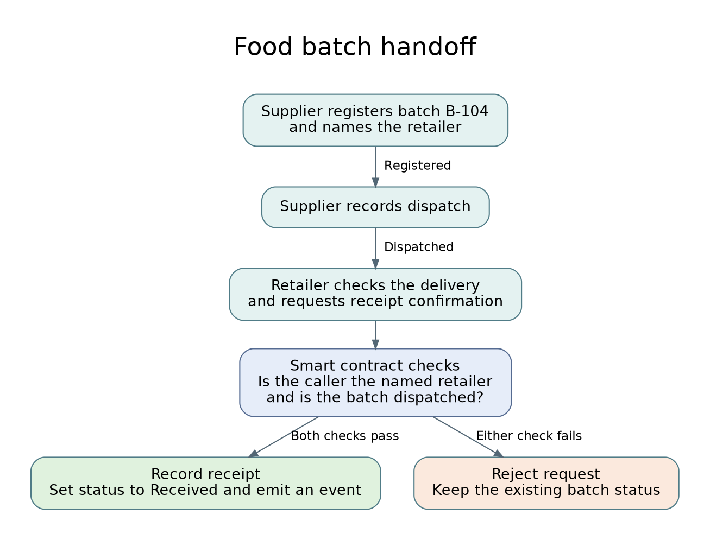

# Food Batch Handoff Design

## The problem

In this example, a supplier sends a batch of food to a retailer. The supplier records when the batch leaves, and the retailer records when it arrives. If their records disagree, the two businesses have to check their delivery notes to work out what happened.

## Proposed workflow

1. The supplier registers food batch B-104 and names the retailer who will receive it.
2. When the batch leaves, the supplier marks it as dispatched.
3. When the delivery arrives, the retailer checks the batch label and confirms receipt in the app.
4. The smart contract records receipt only if the batch was dispatched and the confirmation came from the named retailer. Both parties can then see that B-104 was received.

## Proposed business model

The supplier and retailer would use the app as a shared delivery register. The supplier would pay to register and dispatch each batch. The retailer would pay to record receipt after checking the delivery. Both would need to train staff to use the app.

The supplier could use the register to follow up on unconfirmed deliveries. The retailer would control its own acknowledgement: the supplier could record that B-104 was sent, but only the named retailer could confirm it arrived. If both businesses already trust one organisation to manage a shared database, that simpler option may cost less. Blockchain makes sense here if independent control of each party’s entry is worth the extra cost.

## Recent blockchain advancement

Ethereum’s Dencun upgrade in March 2024 introduced “blobs”, a cheaper way for layer-2 networks called rollups to publish batches of transaction data to Ethereum (Ethereum.org, n.d.).

If a retailer handles hundreds of deliveries a day, even small fees for each dispatch and receipt can add up. For a live deployment, we propose running the handoff contract on a rollup that uses blobs. Each delivery would still have its own record, while the rollup could spread the cost of publishing data across many transactions. Our classroom prototype will use Ganache to test the handoff rules.

Source: Ethereum.org (n.d.) ‘Danksharding’. Available at: https://ethereum.org/roadmap/danksharding/.

## Benefits and limitations

The supplier can see which batches are still awaiting confirmation. If there is a delivery dispute, both businesses can check the same record to see who marked the batch as dispatched and who confirmed receipt.

The record is only as accurate as the information people enter. If the retailer confirms the wrong batch or overlooks damaged food, the blockchain will still record that confirmation.

## Cryptographic method

We chose the Elliptic Curve Digital Signature Algorithm (ECDSA) because the app needs to verify which account authorised each handoff. The retailer’s wallet uses its private key to sign the transaction confirming receipt of B-104. Ethereum uses the signature to identify the sending account. Changing the batch identifier after signing would invalidate the signature for that account (Ethereum.org, n.d., ‘Ethereum accounts’).

The contract then checks whether the sender’s address matches the retailer named for B-104. If another retailer signs with its own key, its signature is valid for its account, but the contract rejects the confirmation because the addresses differ. The named retailer must protect its private key because anyone who obtains it could sign a false receipt.

Source: Ethereum.org (n.d.) ‘Ethereum accounts’. Available at: https://ethereum.org/developers/docs/accounts/.

## How we will test the handoff

| Test | Expected result |
|---|---|
| The supplier registers batch B-104 and names the retailer. | The batch shows as Registered. |
| The named retailer tries to confirm receipt before dispatch. | The contract rejects the request. The batch stays Registered. |
| The supplier marks B-104 as dispatched. | The batch shows as Dispatched. |
| A different account tries to confirm receipt. | The contract rejects the request. The batch stays Dispatched. |
| The named retailer confirms receipt. | The batch shows as Received. |
| The named retailer tries to confirm receipt again. | The contract rejects the second confirmation. The batch stays Received. |
